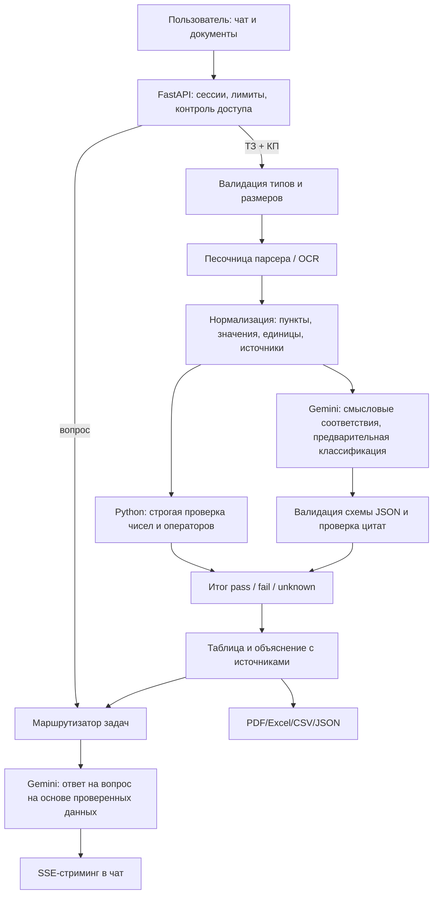

# KrakenAI — архитектура Gemini и анализа коммерческих предложений

Статус: технический проект + начальная интеграция. Не считать систему промышленной без тестов на реальных обезличенных КП и независимого аудита.

## 1. Что такое KrakenAI

KrakenAI — собственный сервис с удобным интерфейсом, чатами, загрузкой документов и проверяемыми инструментами анализа закупок. Базовая языковая модель — Google Gemini через защищённый серверный API. Это **не обучение новой базовой нейросети** и не локальное исполнение Gemini: модель работает в инфраструктуре Google.

Режимы:
- **Общий чат**: вопросы, помощь с текстом, структурирование, объяснения. В дальнейшем — безопасные инструменты и разрешённые действия.
- **Анализ ТЗ / КП**: загрузка до 10 предложений, извлечение данных, смысловое сопоставление, числовая проверка, отчёт.
- **Диалог по анализу**: «почему поставщик Б не подходит?», «какой пункт не выполнен?», «что проверить специалисту?». Отвечать с цитатами и ссылками на исходники.

## 2. Потоки данных



## 3. Загрузка и извлечение

Поддерживаемые форматы сейчас: PDF, DOCX, XLSX, PNG, JPEG. Ограничения пилота: до 5 МБ на файл, не более 10 КП, OCR сканированных PDF ограничен тремя страницами для каждой загрузки. Сервер проверяет сигнатуру, разбор запускает в ограниченном процессе с тайм-аутом. Не выполняет макросы. Это не антивирусная песочница — дополнительные проверки необходимы.

- PDF: извлечение текста, таблиц по возможности, сохранение **точной страницы**; изображения и сканы — OCR.
- DOCX: абзацы, таблицы и номера пунктов; при сложной верстке следует сохранять исходный файл и форматировать в PDF для повторной визуальной проверки.
- XLSX: лист, координата ячейки, значения; никогда не исполнять формулы и макросы.
- PNG/JPG: OCR с русским и английским языками, предупреждать о невысокой уверенности распознавания.
- При ошибке извлечения не «догадаться», а остановить автоматический вердикт.

## 4. Структура нормализованного требования

```json
{
  "requirement_id": "TZ-12",
  "name": "Мощность электродвигателя",
  "operator": "min",
  "required_value": 5.0,
  "unit": "кВт",
  "mandatory": true,
  "source": {"document_id": "tz-1", "page": 4, "quote": "Мощность не менее 5 кВт"},
  "supplier": {
    "document_id": "kp-2",
    "value": 5.5,
    "unit": "кВт",
    "source": {"page": 2, "quote": "Номинальная мощность 5,5 кВт"}
  },
  "python_check": "pass",
  "human_confirmation": "pending"
}
```

Важно: page/quote в демонстрации — **пример**, реальные номера должны быть получены из парсера, а не сгенерированы моделью. Статусы для чисел: pass/fail/unknown. Для субъективных или конструктивных совпадений: potential_match/potential_mismatch/needs_review. Отсутствующий параметр никогда не становится pass.

## 5. Как работает модель

1. Backend получает очищенный текст с источниками; документы рассматривает как **недоверенные данные**.
2. Gemini выделяет смысловые сущности в заданную JSON-схему: изделие, параметры, допуски, срок, гарантию, цену, дополнительные условия.
3. Python проверяет типы, единицы, диапазоны и сохраняет строгую связь с фрагментом источника.
4. Набор инструментов автоматически сравнивает каждое требование с КП, не доверяя LLM математические решения.
5. Модель формулирует пояснение из **проверенных** результатов и отмечает ручные проверки. Текст документа не может переписать системные правила, получить ключи или вызвать неразрешённые инструменты.

Текущая интеграция поддерживает Gemini через OpenAI-compatible Chat Completions с `AI_BACKEND=gemini`, фиксированным HTTPS URL и секретом `GEMINI_API_KEY`. Потоковые ответы передаются в интерфейс через SSE. Это быстрый совместимый слой. Для более широкого мультимодального File API и новейших инструментов следует перейти на официальный `google-genai` Interactions API.

## 6. Чат

- История, собственное название диалога и его связь с анализом;
- Потоковые токены через SSE, остановка/повтор и отображение форматированного текста;
- Вопросы без документов — обычная помощь. Вопросы по ТЗ — только с результатами прикреплённого анализа;
- Будущие инструменты: извлечение выбранной страницы/цитаты, повторная проверка, изменение весов критериев, формирование отчёта, RAG по истории;
- Возможность отменить запрос и строгие лимиты на размер контекста, число файлов, обращения, токены и стоимость.

Пилотная история пока хранится в памяти процесса и исчезает при перезапуске. Продакшен: Postgres, объектное хранилище с шифрованием, RBAC, аудит, фоновые очереди (Redis + worker), политика удаления и резервное копирование.

## 7. Безопасность и приватность

**Никогда не коммитить GEMINI_API_KEY в GitHub и не передавать его в браузер.** Настроить переменную на Render: сервис → Environment → Add environment variable. Предпочтителен отдельный ключ с разрешением только для Gemini API, лимитами и оповещениями о расходах.

Google указывает: в бесплатном уровне Gemini API переданные данные могут использоваться для улучшения продуктов и просматриваться людьми. Конфиденциальные коммерческие предложения не отправлять на бесплатный уровень. Перед работой с реальными документами согласовать договор, доступные регионы, политику хранения, 152-ФЗ, возрастные требования API, и выбрать оплачиваемый/подходящий корпоративный режим. Не обещать соответствие без аудита.

## 8. Критерии приёмки

- 10 КП против одного ТЗ без потери источников и ложных подтверждений на заранее размеченных примерах;
- Все числовые требования проверяются детерминированно, неизвестные данные видны пользователю;
- Отчёты проверяемы по пунктам, страницам и таблицам;
- API-ключ не выходит за пределы сервера;
- Сессии/чужие документы не смешиваются; просмотр логов не раскрывает содержимое;
- Chat streaming и остановка работают в браузере и на телефоне;
- Метрики: precision/recall извлечения, false-pass rate, доля неизвестных статусов, latency и стоимость на анализ.

### Ссылки
- https://ai.google.dev/gemini-api/docs/openai
- https://ai.google.dev/gemini-api/docs/interactions-overview
- https://ai.google.dev/gemini-api/docs/document-processing
- https://ai.google.dev/gemini-api/docs/structured-output
- https://ai.google.dev/gemini-api/docs/api-key
- https://ai.google.dev/gemini-api/terms
