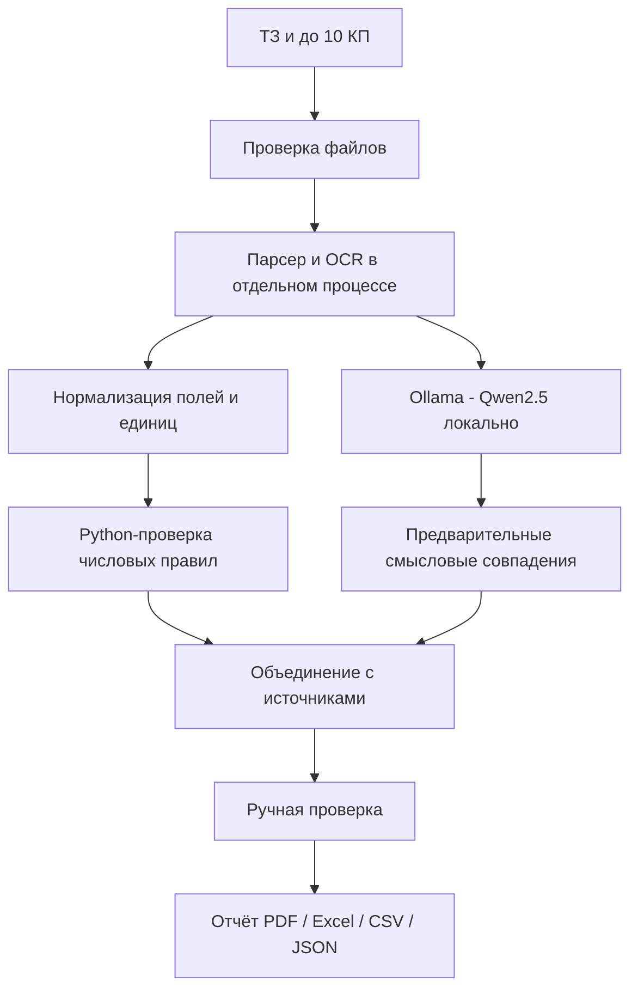

# KrakenAI — дорожная карта по ТЗ (7 рабочих этапов)

**Цель:** полноценная локальная AI-система, которая сравнивает до 10 КП с ТЗ и объясняет каждую оценку. Все цифры времени, точности и безопасности подтверждаются испытаниями, а не формулируются как обещания.

| Этап | Работы | Критерий приёмки | Текущий статус |
| --- | --- | --- | --- |
| 1. Интерфейс | Белая и тёмная темы, единые SVG, чат, панель анализа, мобильная адаптация | Скриншотная проверка по двум референсам 1440×900 и 390×844; UI-контроль клавиатуры | Базовая реализация; 1:1 ещё не подтверждено |
| 2. Документы и OCR | ТЗ + 10 КП, PDF/DOCX/XLSX, сканы PNG/JPEG и PDF, контроль лимитов | Один пакет 10 КП, читаемые цитаты и без тихой потери страниц | Пилот OCR; сканы PDF ограничены 3 страницами |
| 3. Интеллектуальное сопоставление (Т3) | Ollama + Qwen, поля КП, нормализация единиц, семантические кандидаты с цитатами | По каждому требованию `pass/fail/unknown` и отрывок ТЗ/КП; false pass = 0 на тестовом наборе | Числовые правила и предварительные цитаты есть; полного покрытия нет |
| 4. Рейтинг (Т4) | Веса цены, сроков, соответствия ТЗ, надёжности; пересчёт без перезагрузки | Тест с изменением весов и объяснением вклада каждого критерия | Не начато |
| 5. Объяснимость и журнал (Т5) | Ссылки на страницу/строку, подтверждение специалистом, журнал ручных правок | Из любого статуса открывается точная цитата, в журнале автор и время | Цитаты частично; журнал не реализован |
| 6. Защита и 152-ФЗ (Т6) | Изоляция документов, RBAC, Postgres, backup, audit log, отечественный/on-prem хостинг, 1С API | Тесты на чтение чужих файлов, секреты не в репозитории, внешний аудит; документированный API | Только прототип; нормативное соответствие не подтверждено |
| 7. Испытания и запуск | Пакеты обезличенных реальных документов, precision извлечения и точность статусов, нагрузка, UX и видео | Отдельные измерения latency, extraction precision, agreement с экспертом; защищённый пилот | Тесты CI есть, показатели пилота ещё не измерены |

## Приоритеты

Т3 (построчное сравнение с ТЗ) и Т5 (объяснимость и проверяемость) важнее декоративных эффектов. Анимация осьминога не должна закрывать чат и замедлять загрузку документов. Часть 3D пока реализована SVG/Canvas, финальная GLB-модель не создана.

## Локальный AI

Не передавать загруженные коммерческие документы в облачную модель без согласования юридических и технических требований. На публичном Vercel работает только демонстрация интерфейса, для локальной нейросети необходимо запустить Docker Compose на компьютере или собственной инфраструктуре.
